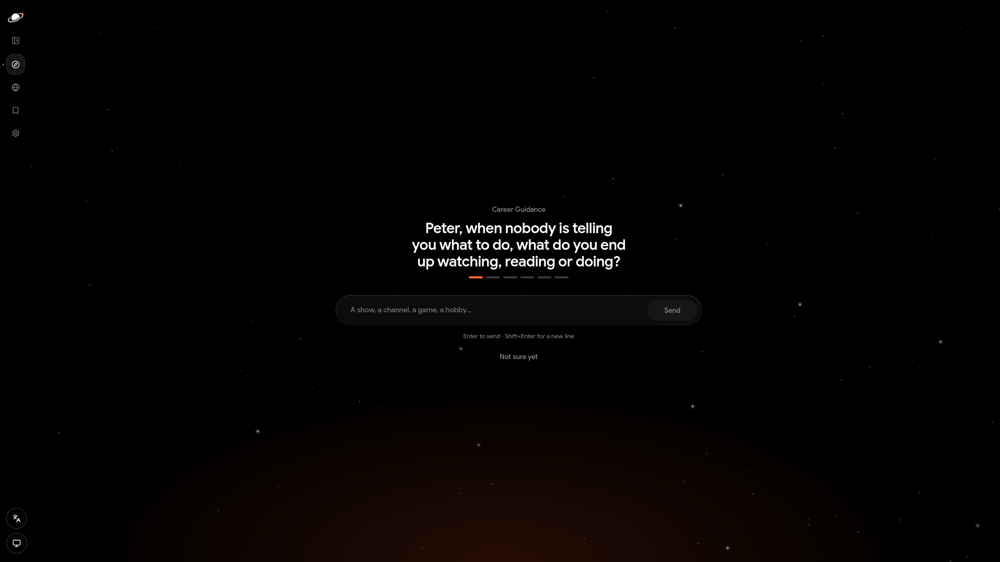
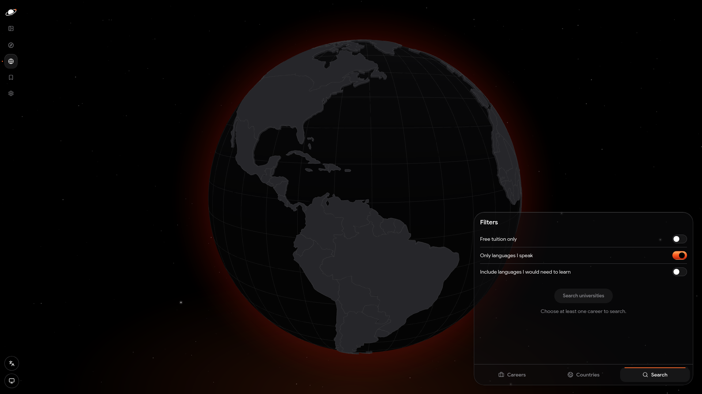
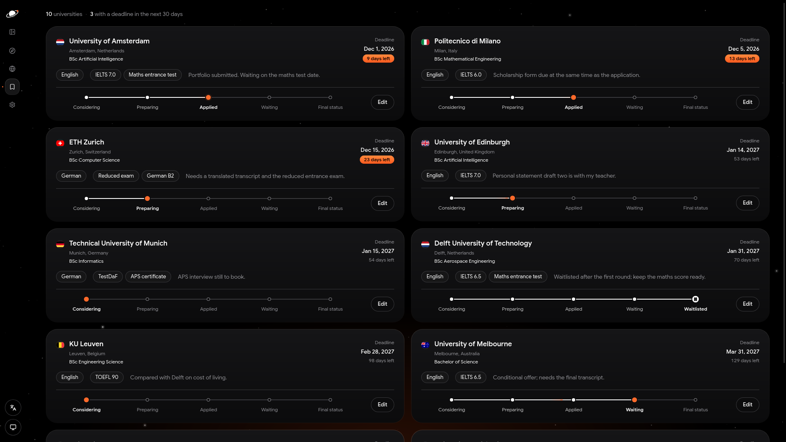
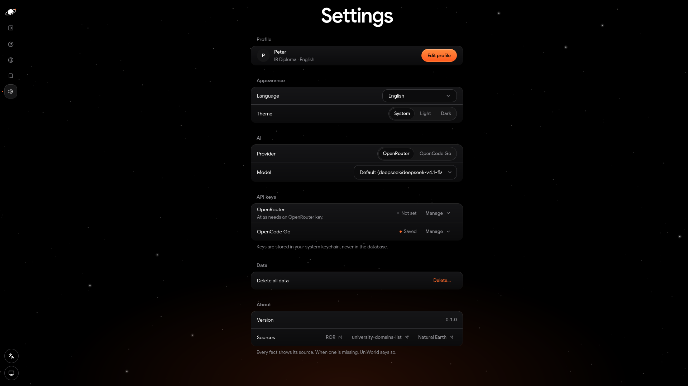

<p align="center">
  <picture>
    <source media="(prefers-color-scheme: dark)" srcset="src/assets/logo/uniworld-mark-dark.svg">
    
  </picture>
</p>

<h1 align="center">UniWorld</h1>

<p align="center">Find real universities worldwide, with a source for every fact.</p>

UniWorld is a desktop app for high-school students in IB, AP or US programs. **Compass** helps the student think through careers, **Atlas** finds universities that teach them, and **Shortlist** tracks every application. Every fact carries a source link and a verified quote, or it says "Not found — check official site". The interface ships in English, Español and Tiếng Việt, in a dark or light theme.

## Screenshots









## Development

Prerequisites: [Bun](https://bun.sh), Rust stable, and the Tauri 2 system dependencies (see https://v2.tauri.app/start/prerequisites/).

```bash
bun install
bun tauri dev
bun run build
bun test
bun run typecheck
bun run check:i18n
bun run build:globe -- <path to ne_110m_admin_0_countries.geojson>
bun run build:ror
```

Project layout: `src/ui` (screens and primitives), `src/app` (shell, routing, wiring), `src/core` (AI, counselor, finder, grounding), `src/store`, `src/i18n`, `src/db`, `src-tauri`, `data/`, `scripts/`.

## Current supported languages

English, Español, Tiếng Việt.

## Data attribution

ROR (CC0), Hipo university-domains-list (MIT), Natural Earth (public domain), `countries-list` (MIT), `country-flag-icons` (MIT), Google Sans (bundled for offline use).

## License

MIT. See [LICENSE](LICENSE).
