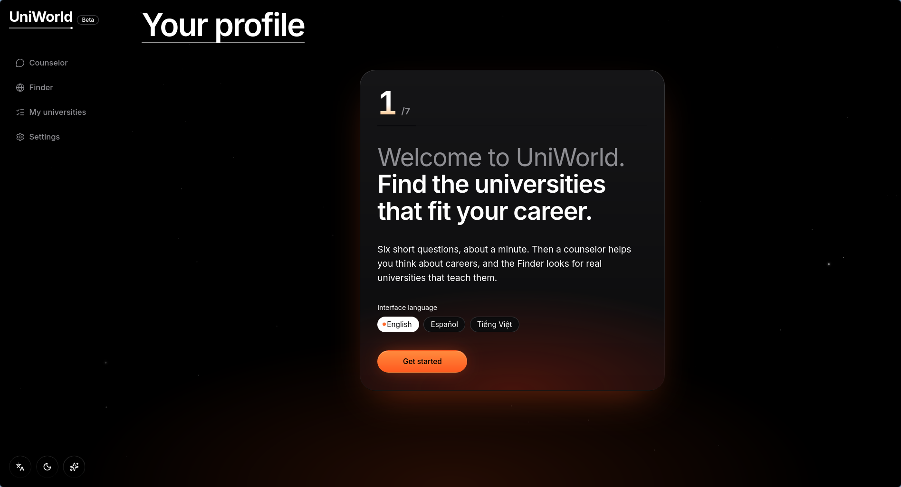
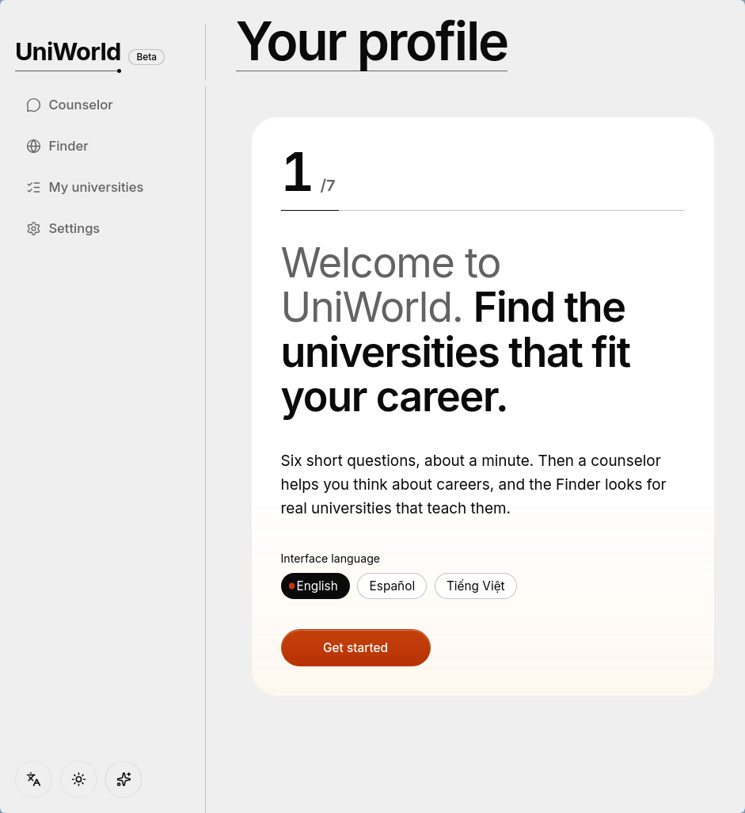
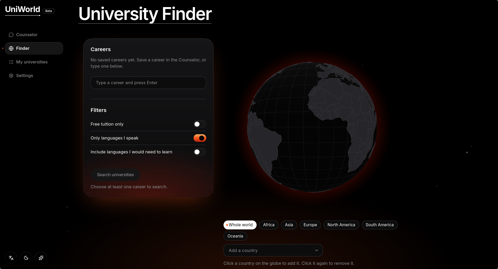

# UniWorld

UniWorld is a desktop app that helps high-school students in IB, AP or US programs find real universities worldwide. A Socratic counselor asks questions about the student's interests and helps them think through careers, and the Finder shows universities that teach those careers. Every fact shown has a source link and a verified quote, or it says "Not found — check official site".

## Screenshots



Onboarding, the welcome step in dark theme.



Onboarding, the name step in light theme.



The University Finder before a search. Pick a career and a region on the globe, then search. Search needs an OpenRouter key.

## Real data only

- No mock data, no demo mode, no seeded profiles.
- The ROR registry matching drops any university that is not in the real registry.
- A citation and quote check turns any unsupported fact into "Not found".
- Search results are cached for 30 days.

## Install

- Windows: download the `.msi` or `.exe` installer from the GitHub Actions artifact of the `Windows build` workflow, or from Releases once a version tag is published.
- Bring your own key: you need an OpenRouter key to search for universities.
  1. Go to openrouter.ai and sign in.
  2. Open Keys and choose Create key.
  3. Paste the key into the onboarding step.
- Keys are stored in the OS keychain. They are never written to the database or to logs.
- OpenCode Go is optional and experimental. It works for the Counselor chat only, not for Finder search.

## Development

Prerequisites: [Bun](https://bun.sh), Rust stable, and the Tauri 2 system dependencies (see https://v2.tauri.app/start/prerequisites/).

```bash
bun install
bun tauri dev
bun run build
bun test
bun run check:i18n
bun run build:globe -- <path to ne_110m_admin_0_countries.geojson>
bun run build:ror
```

On some Wayland compositors, set `WEBKIT_DISABLE_DMABUF_RENDERER=1` before `bun tauri dev`:

```bash
WEBKIT_DISABLE_DMABUF_RENDERER=1 bun tauri dev
```

### Project layout

- `src/ui`: shared UI primitives and screens.
- `src/app`: app shell, routing, and core wiring.
- `src/i18n`: translations (`en`, `es`, `vi`).
- `src/store`: client state stores and secrets access.
- `src/core`: AI clients, counselor, finder, and grounding.
- `src-tauri`: Tauri (Rust) backend and app configuration.
- `data/`: bundled university registry and country data.
- `scripts/`: data builders and command-line tools.

## Languages

English, Español, Tiếng Việt.

## Data attribution

- ROR registry: CC0.
- Hipo university-domains-list: MIT.
- Natural Earth: public domain.
- `countries-list`: MIT.
- `country-flag-icons`: MIT.
- Fonts: Inter (SIL OFL).

## AI tools disclosure

Built with help from AI coding assistants. Person A's UI was planned and orchestrated with Claude Code (Claude Opus as orchestrator, Claude Haiku as builder, Claude Sonnet as reviewer); all generated code was reviewed and tested before commit. The app itself calls models through OpenRouter (default `deepseek/deepseek-v4.1-flash`) or OpenCode Go.

Person B: add your tools here. TODO

## License

MIT. See [LICENSE](LICENSE).
